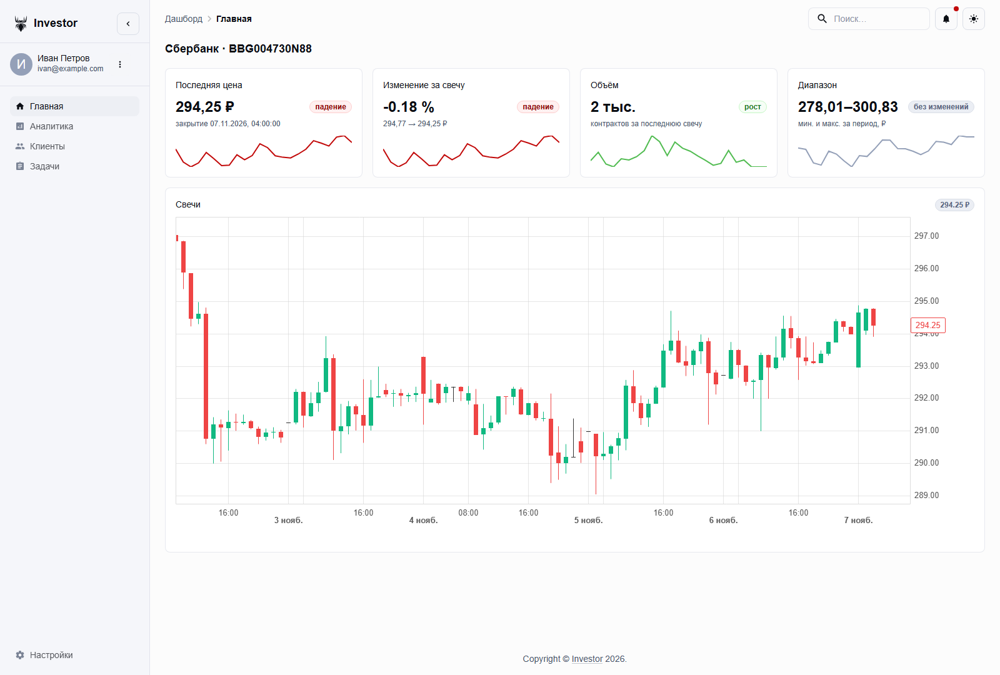
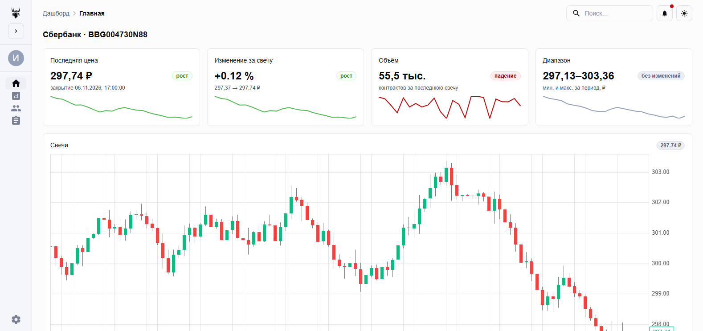
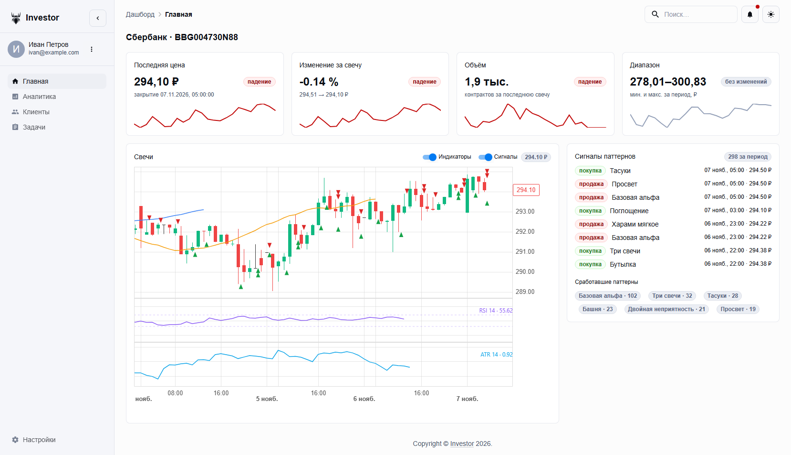
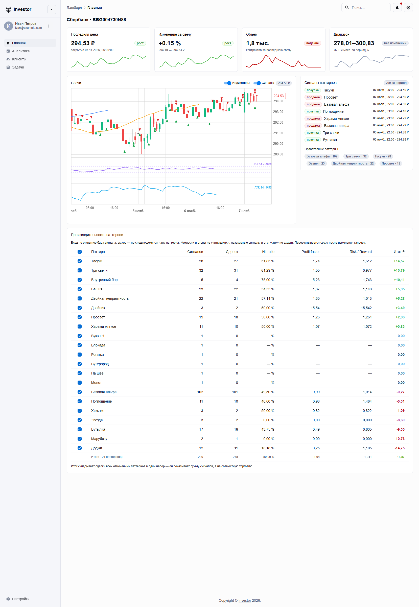

# Frontend — тонкий клиент для `investor`

React + TypeScript + Vite + MUI (Material UI) + RTK Query.
Вёрстка основана на бесплатном шаблоне MUI Dashboard
(`docs/data/material/getting-started/templates/dashboard`, тег `v9.5.0`).

Сейчас здесь один график — свечи; данные идут по цепочке `backend` → `investor`.



## Запуск

```bash
pnpm install
pnpm dev        # http://localhost:5173
pnpm build      # tsc -b && vite build
pnpm lint       # oxlint
```

## Docker

Многоступенчатая сборка: `node:24-alpine` собирает `dist`, `nginx:alpine` его раздаёт.

```bash
cd project
docker compose up --build frontend
# http://localhost:8080
```

- `Dockerfile` — сборка (`pnpm install --frozen-lockfile` + `pnpm build`) и раздача;
- `nginx.conf.template` — SPA-fallback, кэш для `/assets/`, healthcheck `/healthz`
  и прокси `/api/` → `${BACKEND_URL}` с отрезанием префикса;
- `BACKEND_URL` подставляется в конфиг при старте контейнера (envsubst маски
  официального образа), по умолчанию `http://backend:8000`. Достаточно поменять
  переменную, чтобы фронтенд смотрел на бэкенд на другой машине.

## Проверки

```bash
pnpm build                  # tsc -b + vite build
pnpm lint                   # oxlint
node scripts/check-data.mjs # HistoricCandle[] -> DataPoint[] -> карточки
```

`check-data.mjs` прогоняет слой данных через Vite SSR на синтетическом ряду
и проверяет инварианты OHLC, парсимость времени и расчёт карточек. Сеть и backend
для этого не нужны.

## Стек

| Слой | Что используется |
|---|---|
| сборка | Vite 8 |
| UI | `@mui/material` 9.5, `@mui/icons-material`, Emotion |
| состояние и данные | `@reduxjs/toolkit` 2.14 + `react-redux` 9 (RTK Query) |
| график | [`react-candlesticks`](https://reactcandlesticks.com) 0.7 (canvas, ESM, типы в комплекте) |

## Структура

```
src/
  api/
    types.ts          типы T-Invest API: Quotation, HistoricCandle, CandleInterval
                      и аналитика: IndicatorSeries, SignalPoint, AnalysisResponse
    quotation.ts      units + nano <-> number
    investorApi.ts    RTK Query: getAllCandles -> GET /api/candles,
                                 getAnalysis   -> GET /api/analysis,
                                 getPerformance -> GET /api/performance
  store/
    store.ts          configureStore + middleware RTK Query
    hooks.ts          типизированные useAppDispatch/useAppSelector
  hooks/
    useDebouncedValue.ts  значение с задержкой: пачка кликов -> один запрос
  features/candles/
    toDataPoints.ts   HistoricCandle[] -> DataPoint[] для графика
    stats.ts          метрики для карточек сверху
    CandleChartCard.tsx  карточка со свечным графиком, индикаторами и сигналами
  features/analysis/
    analysisLayers.ts свои слои графика: линии индикаторов и отметки сигналов
    SignalsCard.tsx   список последних сигналов и статистика по паттернам
    PerformanceCard.tsx  бэктест паттернов с галочками и пересчётом
  ui/
    dashboard/        шаблон MUI Dashboard (AppNavbar, SideMenu, Header, MainGrid, StatCard…)
    errors/ErrorBoundary.tsx  перехват ошибок рендера: падает карточка, не страница
    shared-theme/     тема MUI и переключатель светлой/тёмной схемы из шаблона
  main.tsx            Provider + Dashboard
```

### Ошибки и отзывчивость

- Каждая карточка (`график`, `сигналы`, `производительность`) обёрнута в
  `ErrorBoundary`, плюс ещё одна граница вокруг всего `MainGrid`. Падение
  рендера показывает сообщение с кнопкой «Повторить» на месте блока, а не
  белый экран на всю страницу.
- Выбор паттернов в таблице производительности дебаунсится на 400 мс
  (`useDebouncedValue`): при быстром перещёлкивании уходит один запрос с
  итоговым набором, а не запрос на клик.

## Откуда взялся шаблон и что в нём изменено

Исходники — [mui/material-ui, v9.5.0](https://github.com/mui/material-ui/tree/v9.5.0/docs/data/material/getting-started/templates/dashboard).
Из шаблона удалено всё, что тянуло `@mui/x-*`, потому что график по условию один — свечи:

| Удалено | Чем заменено |
|---|---|
| `SessionsChart`, `PageViewsBarChart`, `ChartUserByCountry` (x-charts) | один `CandleChartCard` |
| `CustomizedDataGrid` + `internals/data/gridData` (x-data-grid) | — |
| `CustomizedTreeView` (x-tree-view) | — |
| `CustomDatePicker` + `dayjs` (x-date-pickers) | поле убрано из `Header` |
| `SparkLineChart` в `StatCard` (x-charts) | инлайновый SVG-спарклайн |
| `theme/customizations` (charts/dataGrid/datePickers/treeView) | — |
| `CardAlert` — карточка «Plan about to expire» | удалена |
| `SelectContent` — селектор «продукта» | заменён карточкой пользователя |
| `HighlightedCard` — плашка про обновление плана | — |
| `internals/components/CustomIcons` — иконки Sitemark и флагов | — |

Осталась вся оболочка: боковое меню, навбар, хлебные крошки, переключатель темы,
`MenuButton`, `Search`, `Copyright`.

Отличие от исходников в одном месте: в импортах типов добавлен модификатор `type`
(`import { type Theme, alpha }`), потому что Vite включает `verbatimModuleSyntax`.

Правки поверх шаблона:

- `SideMenu` — панель складывается: в свёрнутом виде (72 px) остаются только иконки
  навигации (1.5rem), аватар и логотип без подписи, а подписи пунктов показываются
  тултипами; состояние хранится в `localStorage` (`investor.sidebarCollapsed`) и
  переживает перезагрузку; селектор продукта заменён карточкой пользователя; убран
  `mt: 10` из docs-шаблона (он добавлял 40 px к высоте панели и вызывал прокрутку
  всей страницы), меню больше не скроллится;
- интерфейс на русском: меню, хлебные крошки, поиск, меню пользователя, мобильный
  навбар и aria-подписи; «About» и «Feedback» удалены;
- `Dashboard` — `main` стал flex-колонкой высотой `100dvh`, поэтому копирайт прижат
  к нижней кромке экрана, а не идёт сразу за содержимым;
- `CandleChartCard` — тема графика берётся из `useColorScheme()`, а не из `theme.palette.mode`:
  в MUI 9 при CSS-переменных `palette.mode` не отражает выбранную схему, и график
  оставался светлым в тёмной теме. Подписи оси времени локализованы через
  `Intl.DateTimeFormat('ru-RU')` и показываются в часовом поясе пользователя
  (`xAxis.timeZoneId`): по умолчанию библиотека печатает американский `MM/DD`
  и время в UTC.

Свёрнутая панель (72 px):



## Логотип и иконки

Исходник — `docs/logo-source.png` (силуэт паука на светлом фоне). Из него собран вектор
через [potrace](https://pypi.org/project/potracer/): 8 контуров, `logo.svg` ≈ 2,7 КБ.

| Файл | Назначение |
|---|---|
| `public/logo.svg` | логотип в интерфейсе, `fill="currentColor"` |
| `public/favicon.svg` | иконка вкладки: белая плитка + чёрный силуэт |
| `public/favicon.ico` | fallback 16/32/48 для старых браузеров |
| `public/favicon-{16,32,48,512}.png` | растровый набор |
| `public/apple-touch-icon.png` | 180×180 для iOS (без прозрачности) |

В интерфейсе логотип рендерит `ui/dashboard/internals/components/Logo.tsx` — **как маску**:

```css
mask-image: url(/logo.svg);
background-color: currentColor;
```

Это принципиально: у `` нельзя перекрасить `currentColor`, потому что SVG внутри картинки
изолирован. Маска же берёт цвет у текста, поэтому в тёмной теме паук автоматически белый —
без второго файла и без CSS-фильтров.

Перегенерация после правки исходника:

```bash
pip install potracer pillow numpy
python scripts/make-icons.py
```

## Данные: frontend → backend → investor

```
React (RTK Query) ──GET /api/candles──▶ FastAPI (кэш 5 с) ──HTTP──▶ investor
                                            │                            │
                                     X-Cache: HIT/MISS            PostgreSQL
```

- `src/api/investorApi.ts` — `fetchBaseQuery({ baseUrl: '/api' })`, эндпоинт `getAllCandles`.
- `vite.config.ts` — прокси снимает префикс `/api` и отправляет запрос на
  `http://127.0.0.1:8000`, поэтому в dev всё на одном origin и CORS не нужен.
- backend кэширует ответ на 5 секунд и сообщает состояние заголовками
  `X-Cache: HIT|MISS`, `X-Cache-TTL`, `X-Data-Source: postgres`.
- investor — отдельный сервис на своём порту: обновляет данные по расписанию сам,
  backend знает о нём только адрес (`INVESTOR_API_URL`).
- investor читает свою базу; в T-Invest ходит только его фоновый цикл. Моков нет:
  если токена нет или API недоступен, отдаётся то, что уже сохранено.

Форма ответа — `HistoricCandle` из `t_tech.invest`: цены как `Quotation { units, nano }`,
время в ISO, флаг `isComplete`. `toDataPoints` переводит её в формат графика.

### Запуск цепочки

```bash
# 0) окружение для сервисов — один раз, из project/
#    python -m venv .venv && .venv\Scripts\activate
#    pip install -r investor\requirements.txt -r backend\requirements.txt

# 1) investor — из project/investor
..\.venv\Scripts\python.exe -m uvicorn service.app:app --port 8100

# 2) backend — из project/backend
..\.venv\Scripts\python.exe -m uvicorn fastapi_server.app:app --port 8000

# 3) frontend — из project/frontend
pnpm dev
```

Или всё сразу в контейнерах: `cd project && docker compose up --build`.

### Проверка кэша

```bash
curl -i "http://127.0.0.1:8000/candles" | findstr X-Cache   # MISS, первый запрос
curl -i "http://127.0.0.1:8000/candles" | findstr X-Cache   # HIT в пределах 5 с
curl    "http://127.0.0.1:8000/candles/cache/stats"         # hits / misses / ttl
```

## Индикаторы и сигналы на графике



Аналитику считает investor (`GET /api/analysis`), фронтенд её только рисует:
у библиотеки есть готовые слои индикаторов, но они считают значения сами в
браузере — а нам нужно одно правило для UI, автоброкера и бэктеста.

`src/features/analysis/analysisLayers.ts` объявляет три своих слоя через
`defineLayer`:

| Слой | Где рисуется | Что делает |
|---|---|---|
| `custom:analysis-price` | панель цены | SMA/EMA по готовым точкам API |
| `custom:analysis-rsi` | отдельная панель | RSI + пунктир 30/70 и подпись значения |
| `custom:analysis-atr` | отдельная панель | ATR + подпись значения |
| `custom:analysis-signals` | панель цены | треугольники покупок/продаж по паттернам |

Две тонкости, на которые стоит смотреть при правках:

- **Индексы баров ≠ индексы свечей.** Библиотека строит бары по торговым
  сессиям, и ночью/в выходные барам не соответствует ни одна свеча
  (`dataIndexByBar[bar] === -1`). Поэтому ряд из API раскладывается по барам
  через счётчик свечей (`placeOnBars`), а не прямым индексом.
- **`includeInAutoScale`.** Панель с автоматической шкалой (ATR) не увидит ряд,
  если слой не участвует в автоскейле — линия просто не нарисуется. У ATR и RSI
  флаг включён, у наложений на цену выключен: SMA/EMA и так лежат внутри
  диапазона свечей.

Отметки паттернов включаются и выключаются переключателями «Индикаторы» и
«Сигналы» в шапке карточки — график с 298 отметками на 575 свечей плотный,
и это ожидаемо.

## Производительность паттернов



Ниже графика — таблица бэктеста (PerformanceCard.tsx), данные из
`GET /api/performance`. Метрики повторяют `project/investor/service/performance.py`:
вход по открытию бара сигнала, выход по открытию следующего сигнала того же
паттерна, без комиссий и стопов.

Галочки — единственное управление: клик сразу отправляет выбор на сервер
(`patterns=id1,id2`), и таблица с итогом пересчитываются. Чекбокс в шапке
отмечает и снимает все паттерны, а при частичном выборе показывает
`indeterminate`.

Отдельной кнопки «Пересчитать» нет намеренно: если выбор живёт в двух местах
(отмечено / применено), появляется третье состояние «изменил, но не применил»,
и таблица показывает не то, что отмечено.

Детали, которые легко сломать при правках:

- `available` в ответе всегда полный: он не сужается вместе с выбором,
  иначе после первого пересчёта пропали бы галочки остальных паттернов;
- пустой выбор уходит как `patterns=` (пустая строка), а не как отсутствие
  параметра: «не выбран ни один» и «параметр не задан — считай все» — разные
  запросы;
- ключ кэша на backend включает список паттернов — иначе пересчёт с другим
  набором сигналов вернул бы чужой ответ;
- `total` — сумма сделок выбранных паттернов, а не совместная торговля:
  позиции разных паттернов между собой не согласуются.
### Подсказка к Risk / Reward

В шапке столбца — иконка с расшифровкой шкалы:

| Значение | Как читать |
|---|---|
| меньше 1 | плохо: средний убыток больше средней прибыли |
| 1 – 1,5 | рабочее, если попаданий больше 50–60 % |
| 1,5 – 2,5 | хорошо |
| больше 3 | настораживает: мало сделок или один крупный выигрыш |

Это фактическое отношение (средняя прибыльная сделка ÷ средняя убыточная по
закрытым сделкам), а не запланированное в сделке.

При наведении на конкретное значение считается безубыточный hit ratio
`p = 1 / (1 + R/R)` и сравнивается с фактическим: «безубыток при hit ratio
≥ 38,3 %, сейчас 51,9 % — прибыльно». При R/R = 1 порог 50 %, при 1,5 — 40 %,
при 0,5 — 67 %.